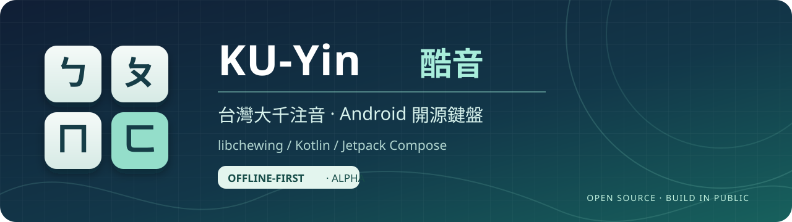

# KU-Yin 酷音｜Android 大千注音開源鍵盤

**為習慣台灣大千注音的 Android 使用者，做一套離線、可以讀懂來源並持續維護的鍵盤。**

KU-Yin 使用 Kotlin／Jetpack Compose 呈現介面，透過 C++ JNI 整合 libchewing 中文解碼；已有注音組字、候選瀏覽與基本英文離線補全。現在公開的是 **Experimental Alpha／Debug APK**，完整裝置、無障礙及更新驗收仍未完成。

[下載 Alpha](https://github.com/juhjuhx/KU-Yin_keyboardforandroid/releases/tag/v0.2.0-aie.1) · [回報問題](https://github.com/juhjuhx/KU-Yin_keyboardforandroid/issues) · [架構](docs/ARCHITECTURE.md) · [建置](docs/DEVELOPMENT.md) · [社群素材](docs/community/README.md)

## 下載與安裝

|身分|目前狀態|
|---|---|
|最新公開下載|`v0.2.0-aie.1`，Experimental Pre-release，Debug 簽章|
|App|`io.github.juhjuhx.kuyin`；`0.2.0-aie.1`／versionCode `20003`；minSdk24／targetSdk36|
|GitHub main|已整合 PR35 的平台契約、Host observer、CI 安全與文件維護；**不是已重新發布的 APK**|
|未發布候選|PR20／27／29 各自審查；新 RC／Stable 仍為 NO_GO|

1. 到 [Release 頁](https://github.com/juhjuhx/KU-Yin_keyboardforandroid/releases/tag/v0.2.0-aie.1) 下載 **`KU-Yin-AIE-S1-candidate-browser-debug.apk`**，並核對同頁 `SHA256SUMS`。
2. 公開 APK 的 SHA256：

   ```text
   acdbacdfebcb897074807bc0746d26ecefbbd8a5f28b25f46aab929afb865634
   ```

3. 安裝後開啟 KU-Yin，依系統設定啟用／選取輸入法；保留原鍵盤，先在非敏感欄位用合成文字試用。
4. 若出現簽章不符或降版錯誤，請停止並回報。**不要為了安裝而卸載、清資料或刪除個人字典。**

自編與 CI 的 Debug 憑證可能不同，不能保證更新既有 Alpha；CI artifact 標記為 TEST_ONLY，不是可無損升級的正式安裝包。歷史 Alpha／舊 tag 保留，最新不代表唯一。

## 真實畫面與 Gallery

目前尚無完成來源／隱私核驗的**鍵盤操作**截圖。Gallery 保留待補狀態，不用品牌圖、Compose Preview 或 Roborazzi 代替。

|需要的畫面|驗證狀態|
|---|---|
|大千41鍵、組字與候選列|BLOCKED：待固定APK／裝置／實際IME視窗證據|
|展開候選／翻頁、英文補全|BLOCKED：待真實軟鍵操作與來源核驗|
|設定／啟用頁|BLOCKED：現有Emulator健康／可拋棄性未取得可信證據，未安裝或擷取|

[圖片與來源清單](docs/community/media/README.md) · [品牌封面與圖卡](docs/community/media/social/README.md)。品牌圖僅作介紹，不是操作證明。

## 已實作的功能

|功能|實作與邊界|
|---|---|
|大千注音41鍵|固定鍵位、聲調／無聲調候選與連續組字；P0-R基本輸入有使用者回報，完整實機矩陣未完成|
|候選瀏覽|橫向單列、展開格狀、上下頁；snapshot／generation／selection identity 防止過期選取；頁數不是全部不重複字庫數|
|英文輸入|QWERTY、Shift／CapsLock、10,000筆固定離線詞表的字首補全，最多8個候選；不是自動修正或上下文預測|
|基本符號／Emoji|標點與固定40個常用Emoji；沒有完整目錄、搜尋或最近使用|
|設定與Editor政策|配色、字級、鍵盤高度、回饋設定；依欄位處理模式／Enter及學習限制，OEM／TalkBack仍待驗|
|Editor寫入確認|Service統一套用ordered commits並處理ACK／失敗尾段；不保證跨IPC端到端exactly-once|

新候選排名、適應觸控、完整個人學習管理／清除、Rime或Whisper都沒有在此版本交付。

## 實際架構

```text
Android App / EditorInfo / InputConnection
                  ↕
KuYinInputMethodService  [lifecycle / policy / editor effects]
  ├─ ComposeDecoderSession  [中文 command / state owner]
  │   ├─ ChewingEngineSession → AndroidChewingEngine
  │   │                         └─ C++ JNI → libchewing
  │   │                            ├─ live composition
  │   │                            └─ scratch candidate preview
  │   └─ ZhuyinDictionarySession  [native啟動失敗時fallback]
  ├─ EnglishWordSession → Local EnglishLexicon
  └─ Compose UI ← immutable candidate snapshots
                    └─ commands → sessions

Service → ordered editor effects → InputConnection → editor ACK
```

UI呈現快照並送出命令；Service負責向其他App寫字。候選預覽使用隔離的`:memory:` scratch context，避免在live組字context開候選。Native ACK與Android editor ACK是不同邊界；App內試打頁使用dictionary路徑，也不能代替真正IME驗收。

詳細生命週期、狀態、資料與錯誤處理見[規範性架構](docs/ARCHITECTURE.md)。

## 技術與上游

|用途|技術／實際來源|
|---|---|
|Android介面／輸入控制|Kotlin、Jetpack Compose、Android SDK／AndroidX|
|中文解碼|libchewing C API、C++17 JNI、Android NDK／CMake|
|建置|Gradle Wrapper9.3.1、AGP9.1.1、Kotlin2.2.10、JDK21|
|詞庫／資料|固定libchewing字典、AOSP LatinIME衍生英文詞表；Native userdict、SharedPreferences與Room各有責任|
|驗證|Java／Kotlin JUnit、Robolectric／Roborazzi、Android Instrumentation／UiAutomator、Python contracts、GitHub Actions|

感謝[libchewing／酷音](https://codeberg.org/chewing/libchewing)、[fcitx5-android/prebuilt](https://github.com/fcitx5-android/prebuilt)、AOSP LatinIME、AndroidX／Compose與相關開源社群。Native prebuilt固定於`3587ba3355711f0aca50136e787719f6562676b8`，對應libchewing source `a6a8fa4abd3f215e3ba89a7b61702eaf8ca68f5c`。

Fcitx5 Android framework、FlorisBoard、HeliBoard、Rime、OpenCC、Whisper屬研究／未來參考，不表示移植其程式碼或Runtime。上游libchewing的Rust實作經靜態archives納入，KU-Yin沒有另交付通用Rust framework或ASR。

根[LICENSE](LICENSE)為標準LGPL-2.1文字；第三方程式、詞庫與媒體各有適用條件。請讀[NOTICE](NOTICE)、[UPSTREAM](docs/UPSTREAM.md)及[來源／重鏈結與授權限制](docs/maintenance/FINAL_LICENSE_REPORT.md)。舊包授權文件異文仍保留勘誤；根文字校正不是全部二進位散布義務完成。

## 為什麼做 KU-Yin？

KU-Yin希望把日常注音輸入做成能讀原始碼、追溯字庫、重現問題並持續維護的開源工程。核心先保留熟悉的大千配置與離線輸入，再改善實際候選瀏覽及Android編輯器互動。

採用libchewing，是為了延續成熟的注音解碼成果；Kotlin／Compose處理Android呈現與互動，JNI提供清楚的Native邊界。這也帶來需要誠實面對的成本：生命週期、候選快照、跨App文字提交、個人資料、原生授權與更新相容性。

工程歷程從Google AI Studio／local donor原型、Compose遷移與C4 native切換，走到P0-R基本輸入修復、AIE-S1候選瀏覽，再經R1–R3.8收束來源、測試、CI與Workspace。AI Agent用於實作、稽核與獨立審查，使用者決定產品與發布；工具輸出仍須由Git/source與測試核對。完整[開發歷史](docs/HISTORY.md)保留歷史角色與證據，不把工具視為法律作者或上游背書。

## 從原始碼建置

需要JDK21、Android SDK36、NDK `28.2.13676358`、CMake `3.22.1`，以及驗證用`dwebp`／`ffmpeg`。環境細節與固定版本見[DEVELOPMENT](docs/DEVELOPMENT.md)。

```bash
git clone https://github.com/juhjuhx/KU-Yin_keyboardforandroid.git
cd KU-Yin_keyboardforandroid
python3 -m pip install -r requirements-verification.txt
export KUYIN_DEPS_CACHE="$(mktemp -d)"
bash scripts/bootstrap_native_deps.sh
python3 -m unittest discover -s scripts/tests -v
for check in scripts/check_*.py; do python3 "$check"; done
./gradlew :app:testDebugUnitTest :acceptance-host:testDebugUnitTest :app:assembleDebug
```

APK位於`app/build/outputs/apk/debug/app-debug.apk`。bootstrap會重建其cache checkout與staged輸出，請使用獨立cache。Gradle成功只證建置；正式簽章及裝置驗收另有Gate。

## 隱私、安全與驗收狀態

產品Manifest不請求INTERNET，中文解碼與英文補全在本機執行；使用者仍可主動開啟外站或分享回饋。Native live context可學習，敏感欄位依EditorPolicy限制；不能宣稱完全不保存輸入資料。

原生userdict位於私有`noBackupFilesDir`，排除Auto Backup不是額外加密；偏好／Room的Android12+ OEM裝置轉移與刪除ACK仍待驗。完整「重設學習」已停用並如實顯示不支援，沒有假裝刪除成功。

PR35整合基線[main CI40220470281](https://github.com/juhjuhx/KU-Yin_keyboardforandroid/actions/runs/40220470281)：Python127、contracts12、App JVM267 PASS/10 native SKIP、Host JVM57 PASS，Build／Lint PASS，**Runtime SKIPPED**。這是固定來源的工程證據；新文件版本以[Actions](https://github.com/juhjuhx/KU-Yin_keyboardforandroid/actions)與[當前狀態](docs/CURRENT_STATE.md)為準。

H0仍INCONCLUSIVE，H1/H2未執行；Host Runtime歷史15 PASS/9 FAIL/8 SKIP，實機未驗收。正式簽章、保資料升級、QR手機掃描、完整source/relink與媒體權利等仍OPEN；**新RC／Stable NO_GO**。詳見[發行門檻](docs/release/RELEASE_READINESS.md)與[Issue19](https://github.com/juhjuhx/KU-Yin_keyboardforandroid/issues/19)。

## 參與維護與直接支持開源

目前進入Maintenance Mode：先處理有重現步驟的單一Issue與安全／相容性缺口，再另行決定新功能。候選順位S2、學習S3、觸控S4、符號S5及語音研究都在[Roadmap](docs/roadmap/AIE_V1_ROADMAP.md)，不由本次收束自動啟動。

回報請提供APK／Android版本、欄位類型、合成文字步驟、預期／實際結果；不要上傳私人輸入、詞庫或未遮蔽日誌。[CONTRIBUTING](CONTRIBUTING.md) · [Security](SECURITY.md) · [Issues](https://github.com/juhjuhx/KU-Yin_keyboardforandroid/issues) · [維護清單](docs/maintenance/MAINTENANCE_BACKLOG.md)。

開發者不收個人贊助；願意支持自由軟體與數位權利，可直接使用基金會官方連結：[FSF](https://my.fsf.org/donate)、[ASF](https://donate.apache.org/)、[OSI](https://members.opensource.org/donate)、[EFF](https://supporters.eff.org/donate/donate)。

已公開Alpha及當前main的舊App內QR圖樣不是標準可解碼QR；PR20有未合併修正，手機實掃仍未驗。請使用上列連結或App的複製／開啟網址功能。捐款直接在機構網站完成；上游及基金會列名是致謝，不代表贊助、認證或背書。
