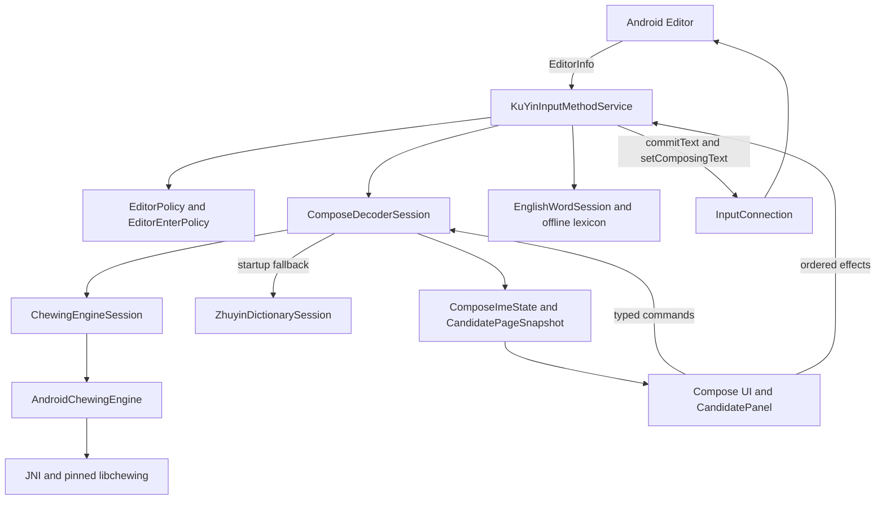

# 系統總覽

狀態：NORMATIVE／IMPLEMENTED（文內 PROPOSED/OPEN 例外）。目的：說明此邊界的實際責任、資料與故障處理。來源基線 `a6a4c654845338521700121ac06586887d1ec085`；R1工具／test-adapter不改產品。

## 實際 source files / evidence

- [app/src/main/AndroidManifest.xml](../../app/src/main/AndroidManifest.xml)
- [app/src/main/java/com/example/ime/KuYinInputMethodService.kt](../../app/src/main/java/com/example/ime/KuYinInputMethodService.kt)
- [app/src/main/java/com/example/MainActivity.kt](../../app/src/main/java/com/example/MainActivity.kt)
- [app/src/main/java/com/example/ime/session/ProductionDecoderResolver.kt](../../app/src/main/java/com/example/ime/session/ProductionDecoderResolver.kt)

## Owner、介面與資料邊界

Android Input Method Framework 建立 service，提供 EditorInfo 與 currentInputConnection。service 管 lifecycle、policy、native live engine及 editor effects；Chinese session 管組字與快照；UI只呈現／派發。resolver native非null用 ChewingEngineSession，啟動失敗才用 ZhuyinDictionarySession；没有 mid-session hot swap或解碼器選單。

MainActivity 是設定、社群與回饋入口，內嵌試打使用另一個 KuYinEngine＋dictionary session，並非 production native IME。舊 ChewingInputMethodService/SettingsActivity/CandidateView仍在source但未被目前manifest註冊。不可把MainActivity試打成果當真editor/native驗收。

Storage side effects限 native userdict、fallback frequency、設定及手動回饋；沒有network候選、Rime/Fcitx runtime、AIE ranker、adaptive touch。錯誤按來源分：startup fallback、無候選／unavailable、editor未確認guard，非全部錯誤均可降級。

## Tests / limitations

StartupOwner/Gate/Resolver、EditorPolicy、P0 native/editor integration及CandidateBrowser tests位於 app/src/test；外部host在acceptance-host。JVM／compile不等同physical typing。S1實機OPEN、production NOT_READY。
