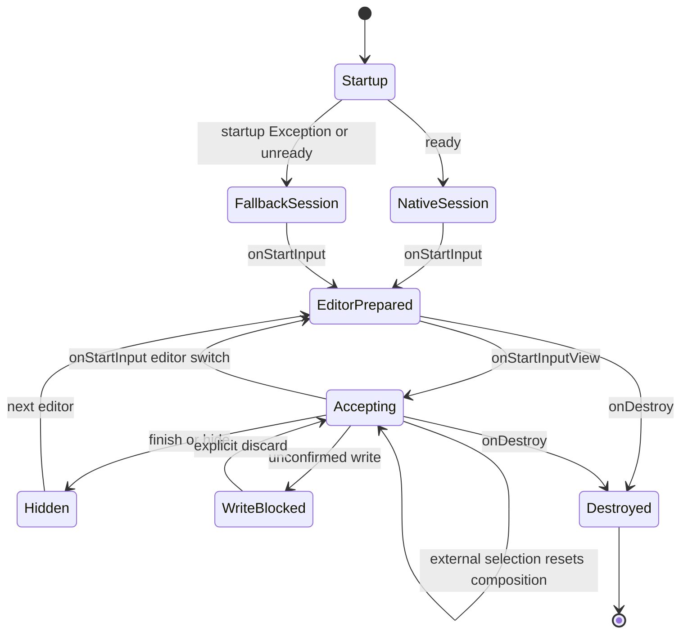

# Android IME 生命週期

狀態：NORMATIVE／IMPLEMENTED（文內 PROPOSED/OPEN 例外）。目的：說明此邊界的實際責任、資料與故障處理。來源基線 `a6a4c654845338521700121ac06586887d1ec085`；R1工具／test-adapter不改產品。

## 實際 source files / evidence

- [app/src/main/java/com/example/ime/KuYinInputMethodService.kt](../../app/src/main/java/com/example/ime/KuYinInputMethodService.kt)
- [app/src/main/java/com/example/ime/service/ImeLifecycleOwner.kt](../../app/src/main/java/com/example/ime/service/ImeLifecycleOwner.kt)
- [app/src/main/java/com/example/ime/service/NativeStartupGate.kt](../../app/src/main/java/com/example/ime/service/NativeStartupGate.kt)
- [app/src/main/java/com/example/ime/service/NativeChewingEngineOwner.kt](../../app/src/main/java/com/example/ime/service/NativeChewingEngineOwner.kt)
- [app/src/main/java/com/example/ime/service/EffectiveModePolicy.kt](../../app/src/main/java/com/example/ime/service/EffectiveModePolicy.kt)

## Ownership / public interface

InputMethodService callbacks 是Android邊界。onCreate 安裝字典、owner.ensureStarted(init once)、Gate僅驗isReady、resolver建立session；同service只有一個持續live engine，scratch contexts另有短暫ownership。Gate捕捉Exception，init失敗owner close後重拋且不留殘engine；不是所有Throwable的恢復保証。onDestroy close once，清記憶體未確認文字。

onStartInput 禁收input、結束自身composition、建立editor generation、normalizepolicy、設定learning、reset Chinese、暫時effective mode。onStartInputView 開input gate並reset Chinese/English，更新Enter metadata。preferred mode只由明確mode選擇改變；非文字／敏感強制English不改使用者偏好。

onUpdateSelection先比對自己write產生的bounded tuple；外部cursor／span失效才reset。finish/hide關輸入gate並失效expanded snapshot；先前View callback不能跨editor寫入。Compose Lifecycle/SavedState/ViewModel owners由ImeLifecycleOwner提供，非Activity lifecycle假設。

## Effects / evidence

初始化可建立noBackup字庫與native userdict；reset不刪個人學習。pendingfailure可能跨editor保留，敏感欄位只顯示遮蔽錯誤、普通欄位顯示待核對字串／明確discard，沒有自動重送。Tests：NativeStartupGateTest、NativeChewingEngineOwnerTest、CandidateBrowserLifecycleTest、EditorCommitRecoveryTest。OEM callback/physical rotation仍未完整驗收；重建Activity不是實體旋轉。
