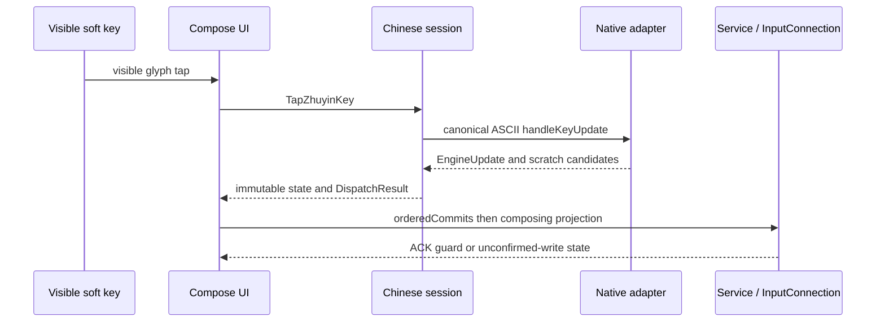

# 輸入與解碼管線

狀態：NORMATIVE／IMPLEMENTED（文內 PROPOSED/OPEN 例外）。目的：說明此邊界的實際責任、資料與故障處理。來源基線 `a6a4c654845338521700121ac06586887d1ec085`；R1工具／test-adapter不改產品。

## 實際 source files / evidence

- [app/src/main/java/com/example/ime/ui/DachenKeyboardRows.kt](../../app/src/main/java/com/example/ime/ui/DachenKeyboardRows.kt)
- [app/src/main/java/com/example/androidkeyboard/input/KeyboardLayout.kt](../../app/src/main/java/com/example/androidkeyboard/input/KeyboardLayout.kt)
- [app/src/main/java/com/example/ime/session/ComposeSession.kt](../../app/src/main/java/com/example/ime/session/ComposeSession.kt)
- [app/src/main/java/com/example/ime/session/ChewingEngineSession.kt](../../app/src/main/java/com/example/ime/session/ChewingEngineSession.kt)
- [app/src/main/java/com/example/ime/session/ZhuyinDictionarySession.kt](../../app/src/main/java/com/example/ime/session/ZhuyinDictionarySession.kt)
- [app/src/main/java/com/example/ime/session/EnglishWordSession.kt](../../app/src/main/java/com/example/ime/session/EnglishWordSession.kt)
- [app/src/main/java/com/example/ime/engine/EnglishLexicon.kt](../../app/src/main/java/com/example/ime/engine/EnglishLexicon.kt)

## Input / output / owner

41個canonical Dachen phonetic/tone keys由KeyboardLayout.Dachen產生Compose rows。UI callback送visible glyph的TapZhuyinKey；native session的label→ASCII code map只來自同源layout（ㄨ=j、ㄛ=i）。不可把使用者口述UO直接當ASCII；raw事件、symbol、native preedit不同表示。

ComposeDecoderSession公開state: StateFlow<ComposeImeState>與dispatch(ImeCommand):DispatchResult。native engine回EngineUpdate(preedit/candidates/committed/consumed/page/unavailable)，session投影generation；KuYinEngine在native路徑負責mode/shift/editor policy，在fallback與試打也擁有dictionary composition，不能全域稱它純presentation。

有Chinese composition時 Enter 完成且consumed，失敗也不外發SEND/newline。候選tap明確完成組字；Space完成Chinese，不額外separator。Punctuation先完成，若native未完成／unavailable不送標點。fallback無候選時可能送raw注音，是較弱降級，不要把native保護泛化。

EnglishWordSession獨立64-char token、最多8候選；EnglishLexicon固定AOSP 10k詞頻TSV，prefix按score/字母排序。Space完成原typedtoken＋一separator，選completion完成候選；password/nontext/FORCE_ASCII直接輸入，NO_SUGGESTIONS/AUTO_COMPLETE另抑制英文建議。無英文autocorrect／learning／network。

## Tests / side effects / limits

Dachen render/mapping、EnterCommand/ModeSwitch、EnglishWordSession/Lexicon、NativeTypingEditorIntegrationTest；fallback explicitselection會記freq prefs，native可自動learn。無新ranker／模型／touch correction。英文跨prefix pointer保護仍非Chinese CandidateRef同等。
