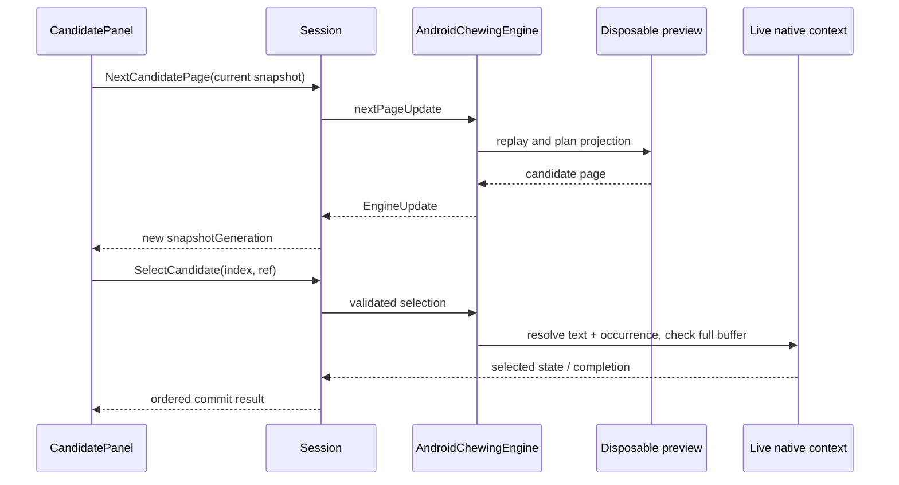

# 候選瀏覽與分頁

狀態：NORMATIVE／IMPLEMENTED（文內 PROPOSED/OPEN 例外）。目的：說明此邊界的實際責任、資料與故障處理。來源基線 `a6a4c654845338521700121ac06586887d1ec085`；R1工具／test-adapter不改產品。

## 實際 source files / evidence

- [app/src/main/java/com/example/androidkeyboard/engines/android/AndroidChewingEngine.kt](../../app/src/main/java/com/example/androidkeyboard/engines/android/AndroidChewingEngine.kt)
- [app/src/main/java/com/example/androidkeyboard/engines/core/ChewingEngine.kt](../../app/src/main/java/com/example/androidkeyboard/engines/core/ChewingEngine.kt)
- [app/src/main/java/com/example/ime/session/ComposeSession.kt](../../app/src/main/java/com/example/ime/session/ComposeSession.kt)
- [app/src/main/java/com/example/ime/session/ChewingEngineSession.kt](../../app/src/main/java/com/example/ime/session/ChewingEngineSession.kt)
- [app/src/main/java/com/example/ime/ui/CandidatePanel.kt](../../app/src/main/java/com/example/ime/ui/CandidatePanel.kt)

## Retrieval ownership

live context管理真正composition/userdict；nativeActions為active replay history，移除auto-committed prefix與已逆轉pending actions。preview context用同system字庫、:memory: userdict、learning off、conversion_engine=2。它不讀personal dictionary，故不宣稱personal ranking。

adapter建立default＋native(text,occurrence) plans；每頁依scratch choice-per-page（預設10）切片，再獨立replay/selection投影完整buffer及每頁display去重。totalPages來自filter/dedup前plans，非unique候選總數；可能一頁較少或空。Next/Previous只改adapter candidatePage再snapshot，不向live送cand_open／方向鍵。不是live native page狀態。

## Public interface / state

CandidatePageSnapshot={compositionGeneration,snapshotGeneration,providerIdentity,pageIndex,pageSize,totalPages?,hasPrevious,hasNext,candidates}；CandidateRef以snapshot/provider/page/selectionIdentity核對同index。native identity為文字＋同文字occurrence，fallback ordinal，是快照內身分，不是跨composition永久ID。

組字更新、reset/editor/hide/close失效prior refs；paging只升snapshot generation，不升composition generation。live selection不盲用scratchordinal；完整buffer mismatch拒絕，replay恢复，但不是persistent learning rollback。

## Presentation / errors / tests

單列LazyRow與展開LazyVerticalGrid，保留preedit，展開暫代main鍵區、有界高度；collapse不commit、不改mode。UI不能JNI。候選空／preview failure可能只回empty，不保證都有unavailableReason。Tests：CandidateBrowserState/Ui/Lifecycle、CandidateIdentityUi、NativeCandidatePagingTest（需host JNI property，否則skip）。physical scroll/page/TalkBack仍OPEN；ranking/touch非此slice。
