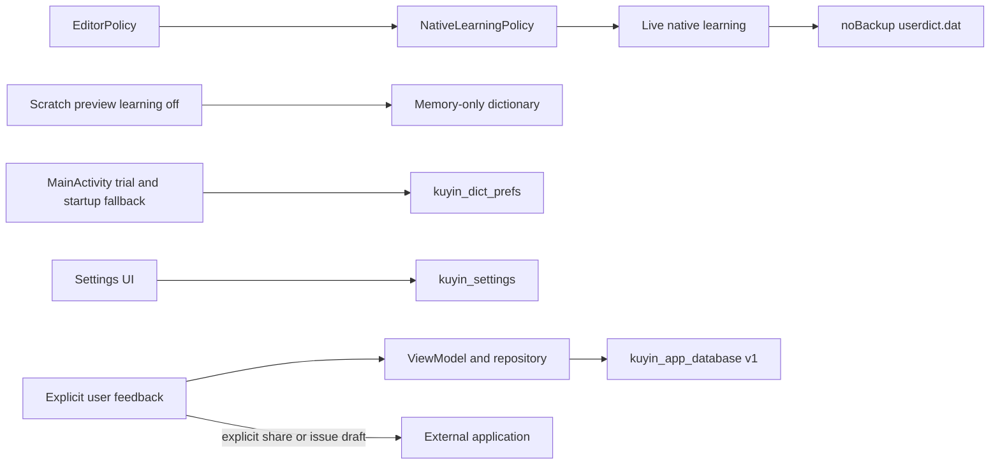

# 資料儲存與隱私

狀態：NORMATIVE／IMPLEMENTED（文內 PROPOSED/OPEN 例外）。目的：說明此邊界的實際責任、資料與故障處理。來源基線 `a6a4c654845338521700121ac06586887d1ec085`；R1工具／test-adapter不改產品。

## 實際 source files / evidence

- [app/src/main/java/com/example/feedback/data/AppDatabase.kt](../../app/src/main/java/com/example/feedback/data/AppDatabase.kt)
- [app/src/main/java/com/example/feedback/data/FeedbackEntity.kt](../../app/src/main/java/com/example/feedback/data/FeedbackEntity.kt)
- [app/src/main/java/com/example/feedback/data/FeedbackDao.kt](../../app/src/main/java/com/example/feedback/data/FeedbackDao.kt)
- [app/src/main/java/com/example/feedback/ui/FeedbackViewModel.kt](../../app/src/main/java/com/example/feedback/ui/FeedbackViewModel.kt)
- [app/src/main/java/com/example/ime/settings/KeyboardSettings.kt](../../app/src/main/java/com/example/ime/settings/KeyboardSettings.kt)
- [app/src/main/java/com/example/ime/service/NativeLearningPolicy.kt](../../app/src/main/java/com/example/ime/service/NativeLearningPolicy.kt)
- [app/src/main/res/xml/data_extraction_rules.xml](../../app/src/main/res/xml/data_extraction_rules.xml)

## Owner / data flows

資料全在本機；native lexicon由libchewing；fallbackfreq由ZhuyinDictionary，IMEfallback及MainActivity內嵌試打都可寫；設定由KeyboardSettings；Room只存使用者主動feedback，不是ranking/touch/learning DB。英文TSV唯讀、不學習。

EditorPolicy password/forceASCII/nontext/NO_PERSONALIZED_LEARNING禁native learning；英文另尊重NO_SUGGESTIONS/AUTO_COMPLETE。沒有通用private mode、personal export/import或全learning erase。S0reset disabled、明示unsupported且零刪除。

Room v1/exportSchema=false、沒有migration/destructive fallback；feedback含description/email/device metadata，手動copy/share/Issue draft可能傳外部app，普通save只local insert。DAO有手動delete/clear，沒有TTL或quota；insert成功callback在Room完成後呼叫；delete/clear的UI成功訊息先於非同步DB結果。nativelearning先於editor ACK，非成功commit後才learn。

## Backup / upgrade / limitations

allowBackup=false与native noBackup store不同保证；Android12+部分OEM的D2D不能仅以allowBackup=false排除，现行XML沒有有效device-transfer excludes。Room/prefs移轉狀態待另安全slice/OEM驗收，不宣稱所有資料皆不可搬移。正常same-signature/versionCode update保留data；本輪沒有device DB inspection/migration/deletion。

完整data schema/retention/rollback見[資料清單](../maintenance/DATA_STORAGE_INVENTORY.md)與[政策](../maintenance/DATA_RETENTION_POLICY.md)。Tests：LearningResetSafetyUiTest、EditorPolicy/NativeLearningPolicy；不是native erase或OEM D2Dproof。
