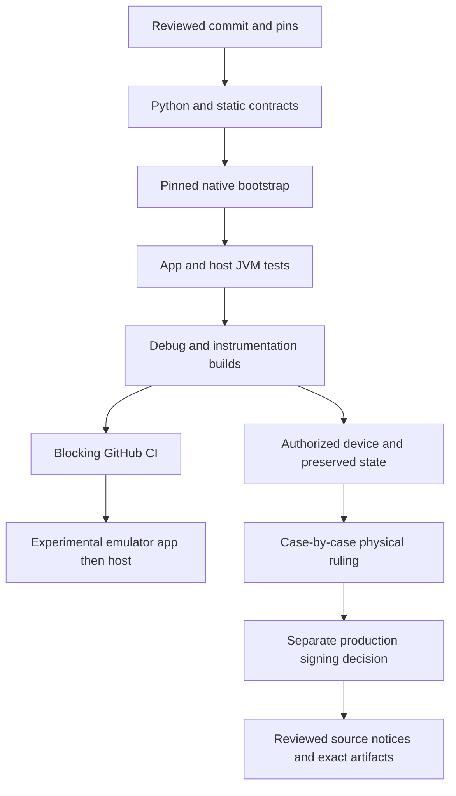

# 建置、測試、CI、發布

狀態：NORMATIVE／IMPLEMENTED（文內 PROPOSED/OPEN 例外）。目的：說明此邊界的實際責任、資料與故障處理。來源基線 `a6a4c654845338521700121ac06586887d1ec085`；R1工具／test-adapter不改產品。

## 實際 source files / evidence

- [app/build.gradle.kts](../../app/build.gradle.kts)
- [acceptance-host/build.gradle.kts](../../acceptance-host/build.gradle.kts)
- [gradle/libs.versions.toml](../../gradle/libs.versions.toml)
- [gradle/wrapper/gradle-wrapper.properties](../../gradle/wrapper/gradle-wrapper.properties)
- [.github/workflows/build.yml](../../.github/workflows/build.yml)
- [.github/workflows/prerelease.yml](../../.github/workflows/prerelease.yml)
- [.github/workflows/upstream-watch.yml](../../.github/workflows/upstream-watch.yml)
- [scripts/runtime_smoke.sh](../../scripts/runtime_smoke.sh)
- [scripts/p1_acceptance_device.py](../../scripts/p1_acceptance_device.py)

## Build / interfaces

JDK runtime21；Java source/target11；Gradle9.3.1/AGP9.1.1，Kotlin/Composeplugin2.2.10，KSP2.3.5，Room2.7，ComposeBOM2024.09。compile36minor1,target36,min24。appID io.github.juhjuhx.kuyin，version20003/0.2.0-aie.1；NDK28.2.13676358/CMake3.22.1/4ABI。詳[DEVELOPMENT](../DEVELOPMENT.md)。

起始CI blocking只7contracts/bootstrap/JVM/Debug；R1補Python全suite與其餘3contracts，使10個靜態合約全覆蓋，並保留instrumentation XML artifact；emulatorcontinue-on-error，工作流success不能遮蔽hostFAIL。runtime_smoke CI-only固定唯一emulator，各suite前重新selectKUYin，不碰physical。P1-G strictmanifest26只适用 frozenP1v3四APK，不适用當前S1 host32；user/subtype preflight特定API35/36安全profile不是productcompatibility限制。

## Provenance / release constraints

PR#8已merge；tag2ce6810与maina6a4c65不同是後續docs-only，不重併S0/S1。發布APK產品source39acf96，Debugsigner与P0相同；CI臨時debugkey不能拿來更新已發布安装。Release Gradle要求keystore，缺失=BLOCKED_BY_SIGNING，不是成功unsignedAPK。

v0.2.0-aie.1為experimental prerelease，保留exact assets與source/relink材料。舊manualprerelease workflow仍會新build/只附APK+SHA，source/notices/signature流程未完备；不得用它發布future產品直至另hardening。R1無release或signer變動。

Tests與fresh/historical在[VALIDATION_MATRIX](../maintenance/VALIDATION_MATRIX.md)。historicalhost32=15PASS/9FAIL/8SKIP、S1physicalOPEN；nativehosttests require property，absence不得假PASS。
