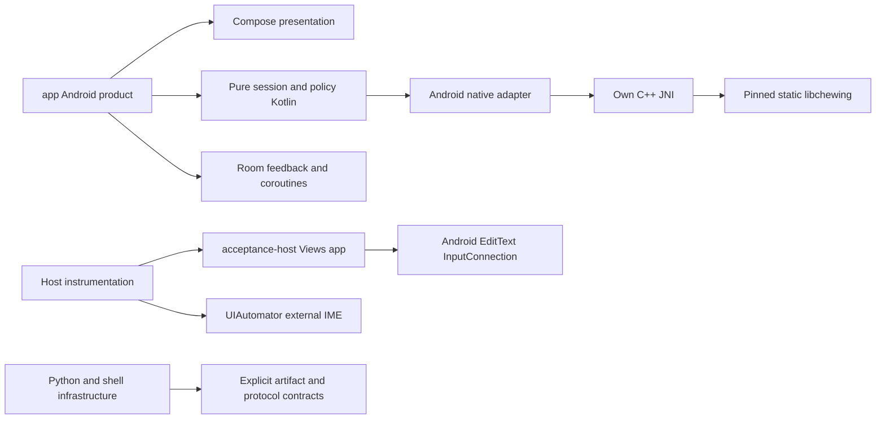

# 模組依賴及擴充

狀態：NORMATIVE／IMPLEMENTED（文內 PROPOSED/OPEN 例外）。目的：說明此邊界的實際責任、資料與故障處理。來源基線 `a6a4c654845338521700121ac06586887d1ec085`；R1工具／test-adapter不改產品。

## 實際 source files / evidence

- [settings.gradle.kts](../../settings.gradle.kts)
- [app/build.gradle.kts](../../app/build.gradle.kts)
- [acceptance-host/build.gradle.kts](../../acceptance-host/build.gradle.kts)
- [app/src/main/java/com/example/ime/session/ComposeSession.kt](../../app/src/main/java/com/example/ime/session/ComposeSession.kt)
- [app/src/main/java/com/example/feedback/data/FeedbackRepository.kt](../../app/src/main/java/com/example/feedback/data/FeedbackRepository.kt)

## Actual modules / public seams

Gradle僅app與acceptance-host；app未depends host，host無product/Compose/libchewing/network dependency。test sharedTest是hostunit+instrumentation的純helpers，不是product插件。Room Repository只有feedback用途，沒有UserLearning資料層。旧View源與TAUIarchive不是activeGradlemodule。

## Extension points / ownership constraints

已實作：ComposeDecoderSession、ChewingEngine core interface、CandidatePageSnapshot、EditorEnterPolicy、EnglishLexicon及FeedbackRepository。backend adapter可替換需明確spike/ADR/typing證据；UI不可跨JNI與editor boundary。

PROPOSED（非production）：AIE-S2 CandidateRanker/personalpreview、UserLearning schema/erase、TouchResolver、SymbolRepository、Rime adapter、M4 Macrobenchmark。不得把它們列為現有dependency或開始本輪implementation。

新元件進入條件：explicitapprovedscope＋schema/license/privacyownership＋回退策略＋RED/GREEN與native/editor界線驗證。native lifecycle、rawDachen事件、snapshot identity、orderedcommitcaller規約不可在重構中產生第二owner。正常revert能回退code，不能當私人DBmigrationrollback。

## Failure / tests / limits

compile dependency boundary與10contracts可防部分靜態漂移，不能證明所有runtime。現有fallback/plainLexicon不是完整pluginframework；assets/learning migration與公開release仍有gates。所有scope狀態參見CURRENT_STATE/ROADMAP，no automaticS2/M4。
